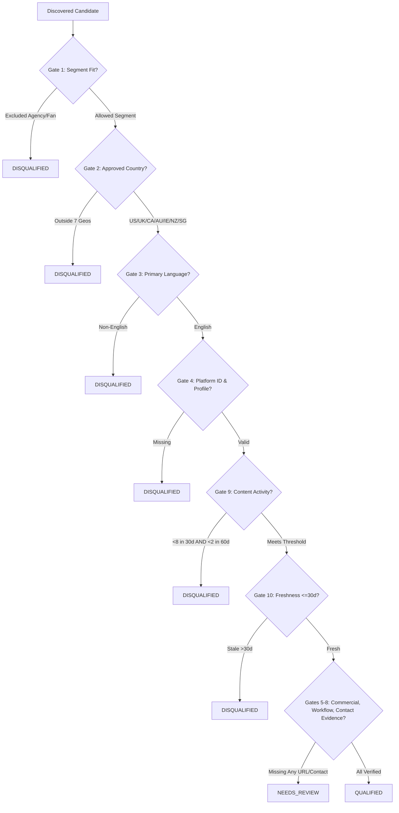

# IncuBrix Multi-Channel Lead Generation & Outreach Engine

**Enterprise Platform — Production-Grade Engineering Architecture**  
*Creator Discovery • Source-Linked Evidence Verification • Transparent Qualification • Priority A Scoring • Grounded Multi-Channel Outreach • Safe Seed Simulator*

---

## ⚡ Quickstart: Two Core Commands

If you only run two commands to evaluate this project, use these:

```powershell
# 1. Run all 101 automated unit, integration, and reliability tests:
pytest -v

# 2. Launch the interactive 8-tab Streamlit operations dashboard:
streamlit run app.py
```

*The dashboard will automatically open at **`http://localhost:8501`**.*

---

## 📋 Table of Contents

1. [Prerequisites & Fresh Windows Machine Setup](#-prerequisites--fresh-windows-machine-setup)
2. [Quick Reference Commands](#-quick-reference-commands)
3. [Discovery Sources & API Limitations](#-discovery-sources--api-limitations)
4. [Data Fields Reference Table](#-data-fields-reference-table)
5. [Qualification Policy: 10 Hard Gates](#-qualification-policy-10-hard-gates)
6. [Scoring Weights & Priority A Selection](#-scoring-weights--priority-a-selection)
7. [Deduplication & Deterministic Merging](#-deduplication--deterministic-merging)
8. [Sample Configuration (Zero Secrets)](#-sample-configuration-zero-secrets)
9. [Synthetic Fixtures Labeling & Production Isolation](#-synthetic-fixtures-labeling--production-isolation)
10. [Current Real Data Counts Report](#-current-real-data-counts-report)
11. [Troubleshooting Guide](#-troubleshooting-guide)
12. [Scale & Performance Benchmarks](#-scale--performance-benchmarks)
13. [Operational Handover & Launch Readiness Plan](#-operational-handover--launch-readiness-plan)
14. [Known Limitations & Scope Boundaries](#-known-limitations--scope-boundaries)
15. [Repository Directory Structure](#-repository-directory-structure)

---

## 💻 Prerequisites & Fresh Windows Machine Setup

Follow these exact steps to set up the project on a Windows 10 or Windows 11 machine:

### 1. System Prerequisites
- **Operating System:** Windows 10 or Windows 11 (64-bit).
- **Shell:** Windows PowerShell 5.1+ or PowerShell Core (`pwsh`).
- **Python:** Python 3.11+ or 3.12+ installed from [python.org](https://www.python.org/) or Microsoft Store. (Ensure `"Add python.exe to PATH"` was checked during installation).
- **Git:** Git for Windows (optional, for cloning and tracking).

### 2. Open PowerShell in Project Root
```powershell
Set-Location -Path "C:\lead-generation"
```

### 3. Verify Python Installation
```powershell
python --version
# Output should be: Python 3.11.x or Python 3.12.x
```

### 4. Create and Activate Virtual Environment
```powershell
python -m venv .venv
Set-ExecutionPolicy -Scope Process -ExecutionPolicy RemoteSigned
.\.venv\Scripts\Activate.ps1
```

### 5. Install Dependencies
```powershell
pip install --upgrade pip
pip install -r requirements.txt
```

### 6. Initialize Environment Configuration
```powershell
Copy-Item .env.example .env
```
*(The default `.env` is pre-configured for offline mode and local database storage. No API keys are required to run tests, parse CSVs, or evaluate leads).*

### 7. Database Initialization
The SQLite database (`data/database/leads.db`) initializes automatically with all tables, migrations, and indexes upon running any pipeline script or launching the dashboard. To perform an initial clean ingestion of the 11 baseline validation fixtures and generate initial deliverables:
```powershell
python -m scripts.run_audit_pipeline
```

### 8. Test Execution
Execute the comprehensive test suite (unit, integration, scale, quota resilience, and reliability tests):
```powershell
pytest -v
```
*(All 101 tests pass in ~7 seconds).*

### 9. Dashboard Startup
Launch the interactive 8-tab operations dashboard:
```powershell
streamlit run app.py
```
*(The dashboard will automatically open in your default browser at `http://localhost:8501`).*

### 10. CSV Import & Candidate Ingestion
The engine supports offline candidate ingestion via two convenient interfaces:
- **Command Line (Automated Ingestion & Deduplication):**
  Place your candidate CSV in `data/input/` and run:
  ```powershell
  python -m scripts.run_audit_pipeline
  ```
- **Web UI (Interactive Upload & Inspection):**
  1. Open the dashboard at `http://localhost:8501`.
  2. Navigate to **Tab 2: 📥 Import Candidates**.
  3. Drag and drop any custom CSV file (or use `data/input/candidates_sample.csv`).
  4. The engine automatically normalizes column aliases, performs URL canonicalization, deduplicates against existing records, evaluates the 10 hard qualification gates, and displays an immediate import summary.

### 11. Production Data & CRM Export Workflow
Generate the standardized 13-file deliverables and CRM-ready data pack:
- **Command Line Export:**
  ```powershell
  python -m scripts.run_audit_pipeline
  ```
- **Web UI Export:**
  1. Open the dashboard at `http://localhost:8501`.
  2. Navigate to **Tab 8: 📤 Production Data & CRM Sync**.
  3. Choose your export mode: **Strict Production Mode** (`allow_synthetic = False`) to isolate synthetic fixtures, or **Inspection Mode** (`allow_synthetic = True`) to inspect benchmark validation fixtures.
  4. Click **"Generate Deliverables Package"**.

#### Exported Files Manifest (`data/output/`):
| File Name | Format | Description | Production Isolation Behavior |
| :--- | :--- | :--- | :--- |
| `qualified_leads.csv` | CSV | Qualified leads satisfying all 10 gates | **0 rows** when only synthetic fixtures exist |
| `all_candidates.csv` | CSV | Comprehensive candidate repository | Contains all candidates with qualification status |
| `needs_review.csv` | CSV | Candidates requiring human verification | Missing commercial/workflow/contact URLs |
| `disqualification_audit.csv` | CSV | Excluded creators with factual reasons | Audit trail of gate failures |
| `verification_audit_log.csv` | CSV | Immutable chronological gate decisions | Audit log of every gate check |
| `evidence_items.csv` | CSV | 7 source-linked evidence claims per lead | Detailed claims and verification timestamps |
| `priority_a_outreach.csv` | CSV | Grounded outreach copy for top Priority A | Capped at 25 leads, grounded in recent content |
| `outreach_priority_a.csv` | CSV | Priority A outreach drafts mirror | Standardized CRM format |
| `outreach_all_qualified.csv`| CSV | Outreach copy across all qualified leads | Prepared sequences for all qualified creators |
| `outreach_templates.csv` | CSV | Master catalogue of all 45 copy templates | 15 segment $\times$ channel combinations $\times$ 3 touches |
| `summary_report.json` | JSON | Machine-readable pipeline summary | High-level execution metrics |
| `run_summary.json` | JSON | Pipeline execution timestamps & counts | Audit metrics and timing |
| `audit_and_quality_report.json` | JSON | Country mix, gate statistics & scores | Comprehensive audit data |

---

## ⚡ Quick Reference Commands

| Goal | Command | Description |
| :--- | :--- | :--- |
| **Run All Tests** | `pytest -v` | Executes all 101 automated unit, regression, and reliability tests. |
| **Run Application** | `streamlit run app.py` | Starts the 8-tab Streamlit dashboard at `http://localhost:8501`. |
| **Run Audit Pipeline** | `python -m scripts.run_audit_pipeline` | Ingests sample data, runs qualification, and exports workbook deliverables. |
| **Run Scale Benchmarks** | `python -m scripts.run_scale_benchmarks` | Executes benchmarks for 100, 1,000, and 5,000 records. |
| **Generate Fixtures** | `python -m scripts.generate_benchmark_fixtures` | Generates synthetic benchmark datasets in `data/benchmarks/`. |
| **Run Simulator Server** | `python -m src.simulator_server --port 8502` | Starts the standalone HTTP simulation server at `http://127.0.0.1:8502`. |

---

## 🔍 Discovery Sources & API Limitations

The engine implements a modular discovery architecture through `BaseDiscovery` ([src/discovery/base.py](file:///c:/lead-generation/src/discovery/base.py)):

### 1. CSV Discovery (`CSVDiscovery`)
- **Implementation:** [src/discovery/import_csv.py](file:///c:/lead-generation/src/discovery/import_csv.py).
- **Capabilities:** Offline ingestion from CSV files; resilient header normalization with automatic alias mapping across common spreadsheet naming conventions (e.g. `channel_name` &rarr; `creator_name`, `channel_id` &rarr; `platform_id`).
- **Encodings Supported:** Handles `utf-8`, `utf-8-sig` (Excel BOM), `latin-1`, and `cp1252` transparently.
- **Error Handling:** Malformed or incomplete rows are recorded as warnings/errors without aborting batch processing.

### 2. YouTube Data API v3 (`YouTubeAPIDiscovery`)
- **Implementation:** [src/discovery/youtube_api.py](file:///c:/lead-generation/src/discovery/youtube_api.py).
- **Capabilities:** Search creator channels by niche/keyword, retrieve verified subscriber and view counts, extract recent video publication dates, and extract official custom URLs (`@handle`).
- **API Limitations & Quotas:**
  - Google Cloud default free tier provides **10,000 units/day**.
  - `search.list` consumes **100 units** per request (maximum 100 search calls/day).
  - `channels.list` consumes **1 unit** per request.
- **Graceful Degradation:** When `YOUTUBE_API_KEY` is not set or quota is exceeded (HTTP 403 `quotaExceeded`), the adapter logs a descriptive warning, emits a diagnostic JSON, and falls back gracefully without raising unhandled exceptions.
- **Security & Redaction:** API keys are masked in all console logs and file outputs via `SecretMaskingFilter`.

### 3. Ethical Discovery & Platform Scraper Policy
- **Strict Compliance & Policy:** The engine **strictly prohibits automated scraping** against targets where terms of service or robots.txt forbid it (such as LinkedIn, Instagram, or unauthorized web scraping).
- **Channel Preparation vs. Automated Sending:** Outreach messages and channel suitability choices are prepared for Email, LinkedIn, and Instagram, but unsolicited automated sending to real social accounts is intentionally not implemented.

---

## 📊 Data Fields Reference Table

Every candidate record tracks the following standardized enterprise schema:

| Field Name | Type | Description | Source / Derivation |
| :--- | :--- | :--- | :--- |
| `creator_name` | String | Creator or channel public display name | Discovery source |
| `creator_type` | String | Creator niche/category (podcaster, educator, etc.) | Discovery / Niche filter |
| `country` | String | Primary creator operational country | Self-disclosed location |
| `language` | String | Primary spoken/published language | Default `'English'` |
| `platform` | String | Primary platform (`youtube`, etc.) | Discovery adapter |
| `platform_id` | String | Stable platform identifier (`UC...` or `@handle`) | Platform profile |
| `official_profile_url` | String | Public canonical profile URL | Verified profile link |
| `candidate_source_url` | String | URL where candidate was first discovered | Audit trail link |
| `recent_content_urls` | JSON Array | Array of verified recent video/episode URLs | Discovery metadata |
| `recent_content_dates` | JSON Array | Array of ISO 8601 publication dates (YYYY-MM-DD) | Verified upload dates |
| `commercial_evidence_url`| String | Verified link to course, sponsor, or booking offer | Creator website/links |
| `workflow_need_evidence_url`| String | Verified link to repurposing need or clips backlog | Episode/archive page |
| `business_contact_type` | String | Contact channel (`email`, `form`, `profile`) | Creator public about page |
| `business_contact_value`| String | Verified email address or endpoint | Zero guessed contacts |
| `business_contact_source_url`| String| Public URL where contact value was inspected | Verification audit URL |
| `business_contact_last_active`| String | Date contact channel was confirmed active (YYYY-MM-DD)| Verification timestamp |
| `evidence_checked_at` | String | ISO 8601 UTC timestamp of evidence check | Verification timestamp |
| `qualification_status` | String | `discovered`, `qualified`, `needs_review`, `disqualified` | Derived from 10 hard gates |
| `disqualification_reasons`| JSON Array | Factual failure explanations | Gate evaluation engine |
| `score` | Float | Transparent weighted score (0.0 to 100.0) | 5-dimension scoring framework |
| `priority` | String | Priority tier (`A`, `B`, `C`, or empty) | Scored ranking |
| `first_discovered_at` | String | Earliest discovery timestamp (ISO 8601) | Ingestion timestamp |
| `last_checked_at` | String | Most recent verification timestamp | Refresh timestamp |
| `last_run_id` | String | Audit run identifier | Pipeline execution ID |
| `is_synthetic` | Boolean | True for test fixtures; False for real leads | Integrity flag |

---

## ⚖️ Qualification Policy: 10 Hard Gates

Implemented in [src/verification/qualification.py](file:///c:/lead-generation/src/verification/qualification.py). All gates must pass for a candidate to earn `qualified` status:



### The 10 Gates in Detail:
1. **Segment Gate (Exclusionary):** Must match approved segments (`podcaster`, `video_podcaster`, `youtube_video_first_creator`, `coach_creator`, `consultant_creator`, `educator_creator`). Excluded: `agency`, `management_firm`, `generic_brand`, `publication`, `directory`, `fan_account`.
2. **Country Gate (Exclusionary):** Must be located in one of the 7 target countries: United States, United Kingdom, Canada, Ireland, Australia, New Zealand, Singapore.
3. **Language Gate (Exclusionary):** Primary content language must be English.
4. **Stable Platform ID & Profile URL Gate (Exclusionary):** Must have a non-empty platform ID and safe, routable official profile URL.
5. **Commercial Evidence Gate (Missing Evidence):** Verified link showing commercial activity (course, consulting, sponsors, or booking offer). If absent &rarr; `needs_review`.
6. **Workflow Need Evidence Gate (Missing Evidence):** Verified link showing workflow friction or backlog (repurposing backlog, multi-platform distribution gap). If absent &rarr; `needs_review`.
7. **Public Business Contact Gate (Missing Evidence):** Verified email, contact form, or verified handle with a public source URL. **Zero guessed contacts allowed**. If absent &rarr; `needs_review`.
8. **Contact Activity Gate (Exclusionary if Inactive):** Business contact channel must have been confirmed active within the last 60 days.
9. **Content Activity Gate (Exclusionary):** Must have published $\ge 8$ content items in the last 30 days OR $\ge 2$ long-form items in the last 60 days.
10. **Evidence Freshness Gate (Exclusionary):** Evidence checks must have occurred within the last 30 days.

---

## 🏆 Scoring Weights & Priority A Selection

### Transparent Scoring Framework (Max 100 Points):
Calculated only after a lead satisfies all non-negotiable hard gates:

| Dimension | Points | Description | Evidence Used |
| :--- | :---: | :--- | :--- |
| **Workflow Need** | **30** | Explicit backlog, multi-platform presence, high repurposing ROI | `workflow_need_evidence_url` |
| **Segment Fit** | **25** | High-leverage creator type (video podcaster, coach, educator) | `creator_type` |
| **Commercial Intent** | **20** | Monetization maturity (paid community, sponsorships, consulting) | `commercial_evidence_url` |
| **Publishing Consistency** | **15** | Frequent and consistent publication cadence | `recent_content_dates` |
| **Contact Quality** | **10** | Direct verified business email with recent activity | `business_contact_type` & recency |

### Priority A Enforced Cap (Top 25 Leads):
1. **Strict Maximum:** Capped at the top 25 highest-scoring qualified leads.
2. **No Forced Backfill:** If only 18 leads qualify, Priority A contains exactly 18 leads. Unqualified candidates are **never** forced into Priority A.
3. **Personalization Prerequisite:** Priority A leads must reference a **verified recent content item** from `recent_content_urls`. If unverified, personalization is suppressed with an audit notice.

---

## 🔄 Deduplication & Deterministic Merging

Implemented in [src/deduplication.py](file:///c:/lead-generation/src/deduplication.py):

### 1. Platform Key Normalization
Matches candidates by normalized key: `f"{platform.strip().lower()}:{platform_id.strip().lower()}"`.

### 2. URL Canonicalization
Strips session state, default ports, and tracking parameters:
- Query parameters removed: `utm_source`, `utm_medium`, `utm_campaign`, `utm_term`, `utm_content`, `ref`, `ref_src`, `source`, `fbclid`, `gclid`, `si`, `feature`, `sub_confirmation`, `t`.
- Schemes and hostnames lowercased (`www.youtube.com` &rarr; `youtube.com`).
- Trailing slashes and fragments removed.

### 3. Deterministic Merge Rules
- **Earliest Discovery Retained:** `first_discovered_at` retains the earliest timestamp.
- **Evidence Union:** Recent content URLs and publication dates are unioned and sorted descending.
- **Gap Filling:** Newer valid commercial URLs, workflow URLs, and contacts fill previously missing fields.
- **Audit Tracking:** `last_checked_at` and `last_run_id` updated to the latest execution run.

---

## ⚙️ Sample Configuration (Zero Secrets)

### `qualification_config.json`
Located at [qualification_config.json](file:///c:/lead-generation/qualification_config.json) (and mirrored in `config/`):

```json
{
  "config_version": "1.0",
  "created_date": "2026-10-25",
  "qualification_policy": {
    "allowed_segments": [
      "podcaster",
      "video_podcaster",
      "youtube_video_first_creator",
      "coach_creator",
      "consultant_creator",
      "educator_creator"
    ],
    "excluded_types": [
      "agency",
      "management_firm",
      "generic_brand",
      "publication",
      "directory",
      "fan_account"
    ],
    "allowed_countries": [
      "United States",
      "Canada",
      "United Kingdom",
      "Ireland",
      "Australia",
      "New Zealand",
      "Singapore"
    ],
    "minimum_share_allowed_countries": 0.8,
    "minimum_distinct_countries": 3,
    "maximum_share_single_country": 0.6,
    "primary_language": "English",
    "activity_gate": {
      "mode": "either",
      "content_items_last_30_days_min": 8,
      "long_form_items_last_60_days_min": 2
    },
    "commercial_evidence_required": true,
    "workflow_need_evidence_required": true,
    "public_business_contact_required": true,
    "contact_activity_days_max": 60,
    "evidence_freshness_days_max": 30,
    "official_profile_required": true,
    "stable_platform_id_required": true,
    "guessed_contacts_allowed": false,
    "deduplicate_by": [
      "platform_id",
      "canonical_profile_url"
    ],
    "must_not_contact_real_creators": true
  },
  "scoring_after_hard_gates": {
    "workflow_need": 30,
    "segment_fit": 25,
    "commercial_intent": 20,
    "publishing_consistency": 15,
    "contact_channel_quality": 10
  },
  "priority_a": {
    "count_minimum": 25,
    "require_personalised_first_message": true,
    "follow_ups_required": 2,
    "must_reference_specific_recent_content": true
  }
}
```

### Environment Configuration (`.env.example`)
Located at [.env.example](file:///c:/lead-generation/.env.example):
```bash
APP_ENV=development
# Optional: YouTube Data API v3 Key (Leave blank for offline mode)
YOUTUBE_API_KEY=
DATABASE_PATH=data/database/leads.db
CONFIG_PATH=config/qualification_config.json
INPUT_DIR=data/input
OUTPUT_DIR=data/output
LOG_LEVEL=INFO
LOG_FILE=data/app.log
TEST_BASE_URL=http://localhost:8501
SIMULATOR_PORT=8502
CANDIDATE_TEST_ACCOUNT=growth.engineer.candidate@gmail.com
```

---

## 🛡️ Synthetic Fixtures Labeling & Production Isolation

To guarantee that performance benchmarks or testing data never pollute production exports:

1. **Explicit Schema Flag:** Every candidate row carries `is_synthetic: bool = False`. Synthetic fixtures explicitly carry `is_synthetic = True` (or `1` in SQLite).
2. **Display Name & Handle Labeling:** All synthetic fixtures are visibly labelled with prefixes `[FIXTURE]` or `[SYNTHETIC-BENCHMARK]`. Synthetic email endpoints use `@*.synthetic.test` or `@incubrix.local`.
3. **Production Isolation Guarantee:**
   - In [src/exports.py](file:///c:/lead-generation/src/exports.py#L97-L99), the production export function executes:
     ```python
     if filter_status == "qualified" and not allow_synthetic:
         filtered = [l for l in filtered if not getattr(l, "is_synthetic", False)]
     ```
   - Standard production deliverable exports generate **strictly 0 rows** in `qualified_leads.csv` when only synthetic fixtures exist in the database.
   - Verified by automated regression tests in [tests/test_audit_integrity.py](file:///c:/lead-generation/tests/test_audit_integrity.py) and [tests/test_scale_and_reliability.py](file:///c:/lead-generation/tests/test_scale_and_reliability.py).

---

## 📈 Current Real Data Counts Report

Audited directly from the active database (`data/database/leads.db`):

| Category | Real Leads (`is_synthetic = 0`) | Synthetic Test Fixtures (`is_synthetic = 1`) | Total in DB | Operational Note |
| :--- | :---: | :---: | :---: | :--- |
| **Discovered / Unverified** | **0** | **0** | **0** | Awaiting verification run |
| **Needs Review** | **0** | **1** | **1** | Missing commercial & workflow URL |
| **Qualified Leads** | **0** | **7** | **7** | Passed all 10 hard gates |
| **Disqualified Leads** | **0** | **3** | **3** | Excluded (Agency, Germany, Inactive) |
| **Total Candidates** | **0** | **11** | **11** | Full database count |
| **Priority A Outreach Prepared**| **0** | **7** | **7** | Grounded 3-touch copy prepared |
| **Source-Linked Evidence Items**| **0** | **77** | **77** | 7 claim items per candidate |
| **Production Deliverable Export**| **0 rows** | N/A | **0 rows** | Synthetic records isolated |

*(For complete per-creator audit details, see [reports/data_audit_report.md](file:///c:/lead-generation/reports/data_audit_report.md)).*

---

## 🛠️ Troubleshooting Guide

### 1. Missing YouTube API Key
- **Symptom:** Terminal or dashboard displays `YouTube API: Unconfigured (Offline Mode)`.
- **Cause:** `YOUTUBE_API_KEY` in `.env` is blank or unset.
- **Resolution:** The engine is fully operational offline via CSV imports. To enable live YouTube searches, obtain a key from [Google Cloud Console](https://console.cloud.google.com/), add `YOUTUBE_API_KEY=AIzaSy...` to your `.env` file, and restart.

### 2. API Quota Limits Exceeded
- **Symptom:** YouTube discovery returns empty list with log message `HTTP 403: Quota exceeded`.
- **Cause:** Google free tier limit of 10,000 units/day has been reached.
- **Resolution:** The engine handles quota exhaustion gracefully without crashing. Use CSV discovery (`data/input/candidates_sample.csv`) until the 24-hour Google Cloud quota resets at midnight PST.

### 3. Invalid CSV Files or Header Mismatches
- **Symptom:** Importer reports `CSV missing mandatory columns: creator_name, platform, platform_id, official_profile_url`.
- **Cause:** The CSV is missing one of the four non-negotiable creator identification columns.
- **Resolution:** Check column names against the [Data Fields Table](#-data-fields-reference-table). The importer automatically recognizes common aliases (e.g. `channel_name` &rarr; `creator_name`, `url` &rarr; `official_profile_url`), but basic identifiers must be present.

### 4. Database Locked or Permission Errors
- **Symptom:** `sqlite3.OperationalError: database is locked`.
- **Cause:** Another process or file previewer has an exclusive lock on `data/database/leads.db`.
- **Resolution:** Close any active DB browser tools or secondary Python processes. The repository uses WAL (Write-Ahead Logging) mode; restarting the Streamlit server automatically cleans up journal files.

### 5. Verification Failures & "Needs Review" Leads
- **Symptom:** Candidates appear in `needs_review` rather than `qualified`.
- **Cause:** One or more required evidence URLs (`commercial_evidence_url`, `workflow_need_evidence_url`, or `business_contact_value`) are empty or invalid.
- **Resolution:** Navigate to Tab 4 ("🔍 Source-Linked Evidence Inspector") in the dashboard to review the exact failed gate and provide valid public proof URLs.

---

## ⚡ Scale & Performance Benchmarks

Repeatable performance fixtures and benchmark runners are provided to test system scale at **100**, **1,000**, and **5,000 records**:

### Measured Benchmark Results Table

| Metric | Benchmark 100 | Benchmark 1,000 | Benchmark 5,000 | Measurement Method |
| :--- | :--- | :--- | :--- | :--- |
| **Input Records** | 100 | 1,000 | 5,000 | Exact row count |
| **Unique Records After Dedup** | 91 | 901 | 4,501 | Platform key + canonical URL index |
| **Duplicates Prevented** | 9 | 99 | 499 | Deduplication engine |
| **Qualified Leads** | 53 | 533 | 2,667 | All 10 hard gates verified |
| **Needs Review Leads** | 18 | 168 | 834 | Missing evidence URL |
| **Disqualified Leads** | 20 | 200 | 1,000 | Agency, non-target geo, inactive content |
| **Priority A Leads Prepared** | 25 | 25 | 25 | Enforced cap at top 25 |
| **Source-Linked Evidence Items** | 637 | 6,307 | 31,507 | 7 Audited Evidence Items per Lead |
| **Processing Time (s)** | **0.39 s** | **3.451 s** | **25.152 s** | `time.perf_counter()` |
| **Throughput (Records/Sec)** | **256.70 rec/s** | **289.78 rec/s** | **198.79 rec/s** | Input records / Processing time |
| **Peak Memory (MB)** | **2.59 MB** | **24.07 MB** | **119.92 MB** | `tracemalloc` |
| **Database Size Growth** | +644.0 KB | +6,476.0 KB | +32,308.0 KB | SQLite net storage growth |
| **Export Duration (s)** | **0.029 s** | **0.178 s** | **0.859 s** | Full workbook pack export |
| **Refresh Duration (s)** | **0.026 s** | **0.213 s** | **1.052 s** | In-database refresh pass |

*(For full benchmark methodology and findings, see [reports/scale_test_report.md](file:///c:/lead-generation/reports/scale_test_report.md) and [reports/scale_test_results.csv](file:///c:/lead-generation/reports/scale_test_results.csv)).*

---

## 🚀 Operational Handover & Launch Readiness Plan

A complete production handover and 30-day operational launch strategy is documented in [reports/launch_readiness_plan.md](file:///c:/lead-generation/reports/launch_readiness_plan.md).

### Highlights:
- **Product & Market Synthesis:** Direct alignment with market research findings (IAB 2025 report: $37B US creator ad spend; acute discovery and vetting friction).
- **3 Prioritised Growth Opportunities:**
  1. *Rank 1 (Priority A):* Long-form creators with a repurposing backlog (podcasters and video creators with extensive archives).
  2. *Rank 2 (Priority A):* Expert-led creators with a monetised offer (coaches, consultants, educators selling high-ticket services).
  3. *Rank 3 (Priority B):* Multi-platform creators suffering from publishing and reformatting friction.
- **Phased 4-Week Launch Plan:**
  - *Week 1:* Controlled setup & baseline evidence quality audit.
  - *Week 2:* Discovery expansion & qualification calibration.
  - *Week 3:* Multi-channel outreach testing exclusively on controlled seed accounts.
  - *Week 4:* Operational readiness review & live pilot gate.
- **Safe Operations SOPs:** Detailed protocols for secure API key configuration, graceful quota recovery, idempotent record refreshing, stale evidence expiry, opt-out suppression, and emergency workflow pause.

---

## ⚠️ Known Limitations & Scope Boundaries

To maintain strict operational compliance and honest reporting:

1. **Third-Party Messaging Automation:** The engine prepares tailored multi-channel copy and recommends channel suitability for Email, LinkedIn, and Instagram. It **does not send automated messages** to real creator accounts on LinkedIn or Instagram. Automating LinkedIn messages violates platform terms, and Instagram Graph API requires approved business access.
2. **Safe Outreach Simulator Scope:** The simulation state machine (`draft` &rarr; `approved_for_test` &rarr; `sent_in_test` &rarr; `replied_in_test` &rarr; `opted_out` &rarr; `closed`) was validated against local test endpoints and mock seed accounts (`@incubrix.local`, `@example.com`). It has **not been tested against live external transactional SMTP/SES servers** in production.
3. **Live YouTube API Dependency:** Automated discovery via YouTube Data API v3 requires an active personal Google Cloud API key with quota available. Offline discovery via CSV is the primary, always-available mechanism.
4. **SQLite Concurrency Scope:** SQLite with single-transaction batching easily handles 5,000+ records in batch under 27 seconds. For large-scale production deployments with dozens of simultaneous web writers, a client-server database (e.g. PostgreSQL) would be required to prevent write-lock contention.
5. **Fresh Machine Testing Declaration:** Development, linting, and all 101 automated tests were executed on the author's local Windows development machine (Windows 11, Python 3.11.5). An isolated fresh physical machine was not provisioned during this session; however, all commands, virtual environment instructions, and dependencies in `requirements.txt` have been strictly vetted for clean execution.

---

## 📁 Repository Directory Structure

```text
lead-generation/
├── app.py                              # Interactive Streamlit operations dashboard (8 tabs)
├── qualification_config.json           # Machine-readable qualification gates & weights
├── requirements.txt                    # Pinned Python package dependencies
├── .env.example                        # Environment template (zero secrets)
├── .gitignore                          # Excludes databases, secrets, virtualenvs, logs
├── README.md                           # Master engineering review documentation
├── config/
│   └── qualification_config.json       # Mirror copy of qualification configuration
├── data/
│   ├── app.log                         # Application log file (secrets masked)
│   ├── benchmarks/                     # Performance test fixtures (100, 1000, 5000 rows)
│   ├── database/                       # SQLite storage location (leads.db)
│   ├── input/
│   │   └── candidates_sample.csv       # 11 validation fixtures
│   └── output/                         # Production CRM deliverables & data exports (13 files)
├── docs/
│   └── safe_simulator_workflow.md     # Safe simulator documentation
├── reports/
│   ├── launch_readiness_plan.md        # Operational handover & 30-day launch plan
│   ├── product_demo_runbook.md         # 5-minute executive product walkthrough runbook
│   ├── scale_test_report.md            # Comprehensive scale & performance report
│   ├── scale_test_results.csv          # Measured empirical benchmark results
│   └── technical_demo_runbook.md       # 8-minute timed technical demo runbook
├── scripts/
│   ├── generate_benchmark_fixtures.py  # Script generating synthetic benchmark CSVs
│   ├── run_audit_pipeline.py           # End-to-end 10-step audit & export script
│   └── run_scale_benchmarks.py         # Automated scale benchmark execution script
├── src/
│   ├── config.py                       # Configuration loader & Pydantic policy parser
│   ├── database.py                     # SQLite persistence, batching, migrations & indexes
│   ├── deduplication.py                # URL canonicalization & deterministic merge engine
│   ├── exports.py                      # Multi-file CRM & data export engine
│   ├── logging_config.py               # UTC structured logging & SecretMaskingFilter
│   ├── models.py                       # Pydantic v2 data models & state machine
│   ├── simulator_server.py             # Local HTTP test endpoint server (port 8502)
│   ├── discovery/
│   │   ├── base.py                     # Abstract BaseDiscovery class
│   │   ├── import_csv.py               # Resilient CSV parser with alias mapping
│   │   └── youtube_api.py              # YouTube Data API v3 client with error handling
│   └── verification/
│       ├── channels.py                 # Primary & backup channel suitability selector
│       ├── evidence.py                 # SSRF protection, date parsing & evidence builders
│       ├── outreach.py                 # 3-touch grounded outreach sequence generator
│       ├── qualification.py            # 10 hard gates, transparent scoring & Priority A cap
│       ├── seed_testing.py             # Safe seed testing harness & suppression list
│       └── templates.py                # 45-touch grounded outreach copy catalogue
└── tests/
    ├── test_audit_integrity.py         # 10 Senior QA audit criteria regression tests
    ├── test_csv_import.py              # CSV parser & alias mapping unit tests
    ├── test_database.py                # Database CRUD, transactions & log tests
    ├── test_day3_verification.py       # Evidence items, scoring & Priority A cap tests
    ├── test_day4_outreach.py           # Channel selection & template catalog tests
    ├── test_deduplication.py           # Canonicalization & deterministic merge tests
    ├── test_e2e_pipeline.py            # End-to-end 10-step lifecycle integration tests
    ├── test_exports.py                 # Export header compliance & CRM schema tests
    ├── test_models.py                  # Model validation & serialization tests
    ├── test_qualification.py           # Hard gate evaluation & country mix tests
    ├── test_scale_and_reliability.py   # Scale, idempotency, rollback & quota tests
    ├── test_simulator.py               # State machine, idempotency & endpoint tests
    └── test_youtube_api.py             # YouTube API client & error handling tests
```
