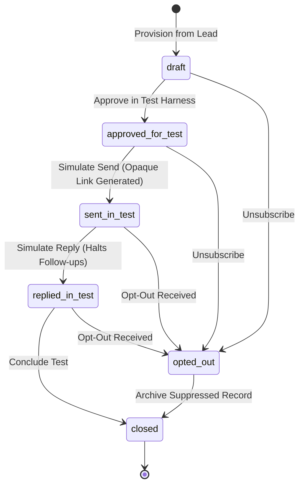

# Safe Outreach Tracking & Reply-State Simulator: Local PowerShell Workflow

## Overview & Safety Guarantees

This document describes how to execute and verify the **Safe Outreach Tracking and Reply-State Simulator** on **Windows PowerShell**.

> [!IMPORTANT]
> **SIMULATION & LOCAL TEST WORKFLOW ONLY**
> - **Zero Contact with Real Creators:** All generation is strictly message preparation.
> - **No Social Automation:** Does not send emails, LinkedIn InMails, or Instagram DMs.
> - **Isolated Test Seeds:** Delivery and reply events operate exclusively on candidate-controlled accounts (e.g., `@incubrix.local`, `@example.com`).
> - **Opaque Tracking URLs:** Tracking links use configured test base URLs (e.g., `http://localhost:8501/?trk=...`) and unguessable opaque IDs. **Never contains names, emails, handles, or numeric lead IDs.**
> - **Unambiguous Labeling:** All simulation views, metrics, and exports are explicitly stamped as **SIMULATED TEST DATA**.

---

## 1. Quick Start: Run Automated Tests

To execute the test suite validating state transitions, duplicate event idempotency, invalid transitions, opt-out suppression, and zero-PII tracking links:

```powershell
# In Windows PowerShell from c:\lead-generation
pytest tests/test_simulator.py -v
```

To run the entire project test suite across all modules (Discovery, Hard Gates, Scoring, Outreach, Exports, Simulator):

```powershell
pytest -v
```

Expected output:
```text
tests/test_simulator.py::test_unique_outreach_record_per_lead_and_campaign PASSED
tests/test_simulator.py::test_full_valid_state_lifecycle PASSED
tests/test_simulator.py::test_invalid_state_transitions_raise_error PASSED
tests/test_simulator.py::test_idempotency_duplicate_event_submissions PASSED
tests/test_simulator.py::test_invalid_event_types_rejected PASSED
tests/test_simulator.py::test_opt_out_suppresses_further_followups PASSED
tests/test_simulator.py::test_tracking_link_generation_opaque_and_no_pii PASSED
tests/test_simulator.py::test_event_logging_utc_timestamp_campaign_and_test_account PASSED
tests/test_simulator.py::test_http_simulator_endpoints PASSED

============================== 79 passed in 3.4s ==============================
```

---

## 2. Launching the Interactive Streamlit Simulator Dashboard

Run the Streamlit application on local port 8501:

```powershell
python -m streamlit run app.py --server.port 8501
```

Once running:
1. Open your browser at [http://localhost:8501](http://localhost:8501).
2. Click on **Tab 6: 📡 Safe Outreach Simulator (Test Mode)**.
3. Review the **⚠️ OUTREACH TRACKING & REPLY-STATE SIMULATOR — TEST DATA ONLY** banner.
4. **Provision Records:** Click `➕ Provision Test Records for Campaign` to seed records from qualified leads in `draft` state.
5. **Progress States:** Select a record and click `1. Approve for Test` &rarr; `2. Simulate Send` &rarr; `3. Simulate Click` &rarr; `4. Simulate Reply` &rarr; `🔒 Close Record`.
6. **Verify Idempotency:** In the Idempotency Sandbox, click `🧪 Submit Event with Key` multiple times. Notice that the first submission creates Event #X, while repeated clicks return the existing event without duplicating rows.
7. **Verify Suppression:** Click `🛑 Simulate Opt-Out ('stop')`. Notice the contact immediately enters the suppression list and subsequent sends are blocked.

---

## 3. Running the Local HTTP Test Endpoint Server

For headless, programmatic, or CI testing, launch the dedicated lightweight HTTP test server:

```powershell
# Start local HTTP test harness on port 8502
python -m src.simulator_server --port 8502
```

The server listens on `127.0.0.1:8502` and supports standard REST endpoints.

---

## 4. Interacting with the Simulator via PowerShell (`Invoke-RestMethod`)

Open a new PowerShell terminal while the simulator server or Streamlit app is active:

### A. Health Check
```powershell
Invoke-RestMethod -Uri "http://127.0.0.1:8502/health" -Method Get | ConvertTo-Json
```
*Response:*
```json
{
  "status": "healthy",
  "service": "IncuBrix Outreach Simulator Local Endpoint",
  "mode": "SIMULATION_TEST_ONLY"
}
```

### B. Simulate Outreach Send (with Idempotency Key)
```powershell
$SendBody = @{
    lead_id = 1
    campaign_id = "powershell_test_camp"
    test_account_id = "candidate@incubrix.local"
    idempotent_key = "ps_send_key_001"
} | ConvertTo-Json

$SendResponse = Invoke-RestMethod -Uri "http://127.0.0.1:8502/api/simulate/send" -Method Post -Body $SendBody -ContentType "application/json"
$SendResponse | ConvertTo-Json
```

### C. Demonstrate Idempotency (Repeat Identical Send Request)
Run the exact same command again:
```powershell
$DuplicateResponse = Invoke-RestMethod -Uri "http://127.0.0.1:8502/api/simulate/send" -Method Post -Body $SendBody -ContentType "application/json"
$DuplicateResponse | ConvertTo-Json
```
*Notice:* `created: false` and `is_duplicate: true`. The event was not duplicated in SQLite.

### D. Simulate Tracking Link Click (Opaque ID)
```powershell
$OpaqueId = $SendResponse.opaque_id
Invoke-RestMethod -Uri "http://127.0.0.1:8502/track?id=$OpaqueId" -Method Get
```

### E. Simulate Creator Reply
```powershell
$ReplyBody = @{
    opaque_id = $OpaqueId
    reply_text = "Hi, yes we are interested in scheduling a 15-minute briefing."
    test_account_id = "candidate@incubrix.local"
} | ConvertTo-Json

Invoke-RestMethod -Uri "http://127.0.0.1:8502/api/simulate/reply" -Method Post -Body $ReplyBody -ContentType "application/json" | ConvertTo-Json
```

### F. Simulate Opt-Out Request
```powershell
$OptOutBody = @{
    contact = "candidate@incubrix.local"
    channel = "email"
    campaign_id = "powershell_test_camp"
    reason = "Creator replied unsubscribe"
} | ConvertTo-Json

Invoke-RestMethod -Uri "http://127.0.0.1:8502/api/simulate/opt-out" -Method Post -Body $OptOutBody -ContentType "application/json" | ConvertTo-Json
```

### G. Retrieve Aggregated Campaign Metrics
```powershell
Invoke-RestMethod -Uri "http://127.0.0.1:8502/api/simulate/stats?campaign_id=powershell_test_camp" -Method Get | ConvertTo-Json
```

---

## 5. Direct SQLite Inspection via PowerShell

To inspect the SQLite persistence tables without third-party tools:

```powershell
# Inspect unique outreach records per campaign
python -c "from src.database import get_default_database; db = get_default_database(); print(f'Total records: {len(db.get_campaign_outreach_records())}')"

# View recent simulated delivery and reply events
python -c "from src.database import get_default_database; db = get_default_database(); events = db.get_delivery_events(limit=5); [print(f'{e.timestamp} | {e.event_type} | {e.recipient_contact} | Status: {e.status}') for e in events]"

# Inspect global opt-out suppression list
python -c "from src.database import get_default_database; db = get_default_database(); [print(f'Suppressed: {s.contact_value} | {s.channel} | {s.reason}') for s in db.get_suppression_list()]"
```

---

## 6. Architecture & State Machine Specification



### State Definitions
| State | Description | Allowed Next States |
|---|---|---|
| `draft` | Initial outreach preparation record created for a lead and campaign. | `approved_for_test`, `opted_out`, `closed` |
| `approved_for_test` | Verified safe test endpoint approved for execution in local test harness. | `sent_in_test`, `opted_out`, `closed` |
| `sent_in_test` | Outreach simulated; opaque tracking token and UTC timestamp logged. | `replied_in_test`, `opted_out`, `closed` |
| `replied_in_test` | Reply recorded; subsequent automated touches strictly halted. | `opted_out`, `closed` |
| `opted_out` | Recipient requested suppression; contact added to permanent suppression table. | `closed` |
| `closed` | Terminal state; campaign outreach cycle concluded. | *None (Terminal)* |
